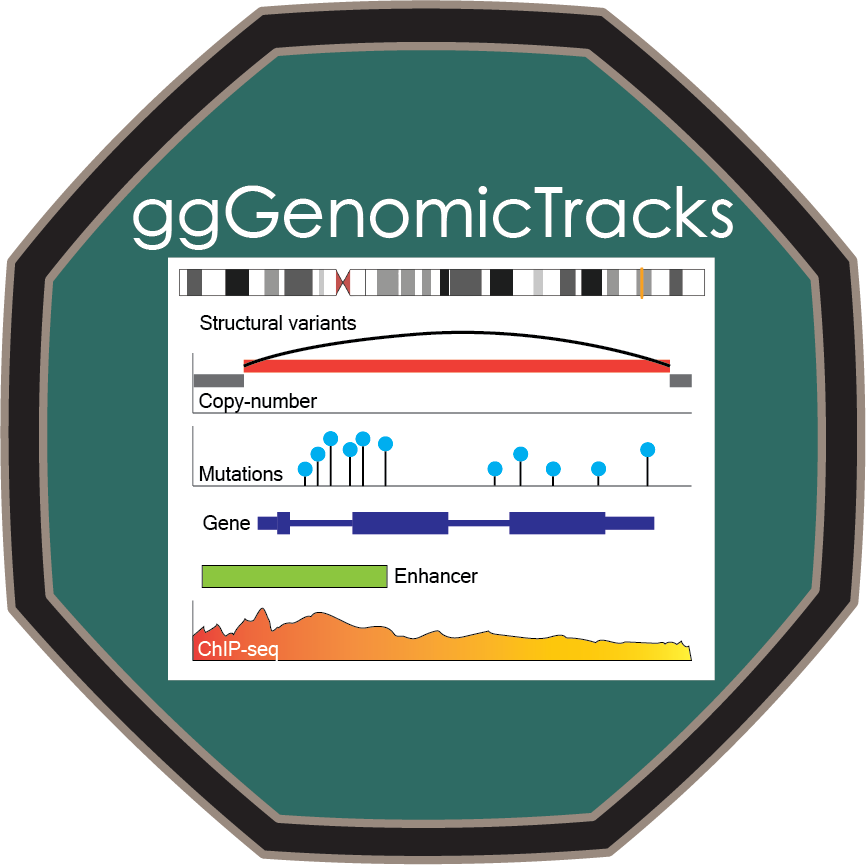

<!-- README.md is generated from README.Rmd. Please edit that file -->

```{r, include = FALSE}
knitr::opts_chunk$set(
  collapse = TRUE,
  comment = "#>",
  fig.path = "man/figures/README-",
  out.width = "100%"
)
```

# ggGenomicTracks 

<!-- badges: start -->
[](https://github.com/pblaney/ggGenomicTracks/issues)
[](https://github.com/pblaney/ggGenomicTracks/pulls)
[](https://lifecycle.r-lib.org/articles/stages.html#experimental)
[](https://github.com/pblaney/ggGenomicTracks/actions/workflows/pkgdown.yaml)
<!-- badges: end -->

Genomic track visualizations built
within the `ggplot2` framework

`ggGenomicTracks` provides genomic tracks as standard
[`ggplot2`](https://ggplot2.tidyverse.org) layers that can be stacked, themed, and
combined like any other plot: copy number (total and allele-specific), structural
variant junctions, binned coverage, genes, mutations, chromatin states, and
ideograms. Coordinate systems place one or more genomic windows, cis or trans, or the
whole genome on a single x-axis, so junctions can be drawn between loci in the style
of [gTrack](https://github.com/mskilab-org/gTrack). It is the graphical companion to
[`devgru`](https://pblaney.github.io/devgru/), and by default is anchored to hg38.

Full documentation and the function reference are available at
<https://pblaney.github.io/ggGenomicTracks/>.

### Installation

You can install the current development version of `ggGenomicTracks` with:

```{r 'install_dev', eval = FALSE}
devtools::install_github("pblaney/ggGenomicTracks")
```

Some dependencies are only available on GitHub
([`pblaney/devgru`](https://github.com/pblaney/devgru) and
[`mskilab-org/gUtils`](https://github.com/mskilab-org/gUtils)); these are declared as
`Remotes` and resolved automatically by `devtools`/`remotes`.

### Function Overview

| Category | Functions |
|---|---|
| **Coordinate systems** | `coord_locus()` for one window, `coord_loci()` for several windows on one axis, `coord_genome()` for the whole genome |
| **Stacking tracks** | `stack_tracks()` aligns track plots on shared coordinates; `highlight_stack()` marks regions across all tracks |
| **Copy number** | `geom_copy_number()` for total or allele-specific integer copy number |
| **Structural variants** | `geom_junction()` for cis and trans junction arcs, `geom_loose_end()` for loose ends |
| **Coverage and signal** | `geom_coverage()`, `geom_ridge_track()`, `geom_bed_track()`, `geom_epilogo_col()` |
| **Mutations** | `geom_mutation_count()`, `geom_vaf_landscape()` |
| **Genes and annotations** | `geom_gene_track()`, `annotation_locus_scale()` |
| **Ideograms** | `geom_ideogram()`, `plot_ideogram()`, `annotate_ideogram_window()`, `annotate_ideogram_zoom()` |
| **Scales and themes** | `scale_fill_copynumber()`, `scale_colour_sv_class()`, `scale_colour_jabba_event()`, `scale_fill_chromhmm()`, `scale_fill_giemsa()`, `theme_genomic()` |
| **Data preparation** | `junction_copy_number()`, `loose_end_copy_number()`, `annotate_junctions()`, `epilogos_long()` |

See the [reference page](https://pblaney.github.io/ggGenomicTracks/reference/index.html) for full details on each function.

### Quick Start

Draw copy number with junctions anchored at the copy number of each breakpoint, across
several windows:

```{r 'copy_number', eval = FALSE}
library(ggGenomicTracks)
library(ggplot2)

cn <- data.table::fread("sample.jabba.cnv.bed")
data.table::setnames(cn, "chrom", "seqnames")
junctions <- devgru::read_bedpe_file("sample.jabba.junctions.bedpe", output_type = "dt")
junctions <- annotate_junctions(junction_copy_number(junctions, cn))

windows <- c(MYC = "chr8:126000001-130000000", IGH = "chr14:105000001-107000000")

ggplot() +
  geom_copy_number(data = cn) +
  geom_junction(data = junctions, aes(y = cn1, yend = cn2, colour = sv_class)) +
  scale_colour_sv_class() +
  coord_loci(windows) +
  theme_genomic()
```

Stack copy number, allele-specific copy number, and coverage tracks on shared
coordinates, here genome-wide:

```{r 'stack', eval = FALSE}
coverage <- readRDS("sample.fragcounter.cov.rds")

stack_tracks(
  ggplot() + geom_copy_number(data = cn) + theme_genomic(),
  ggplot() + geom_copy_number(data = cn, alleles = TRUE) + theme_genomic(),
  ggplot(coverage) + geom_coverage(y_range = c(0, 3)) + theme_genomic(),
  windows = "genome",
  heights = c(1.3, 1, 0.8)
)
```

### Bundled Data

`ggGenomicTracks` ships with hg38 cytobands (`cytobands_hg38`) for ideograms. The raw
file it was built from is in `inst/extdata/`.

### Citation

To cite `ggGenomicTracks` in publications, use:

```{r 'citation', eval = FALSE}
citation("ggGenomicTracks")
```

### Contributing

Bug reports and feature requests are welcome on the
[issue tracker](https://github.com/pblaney/ggGenomicTracks/issues).
